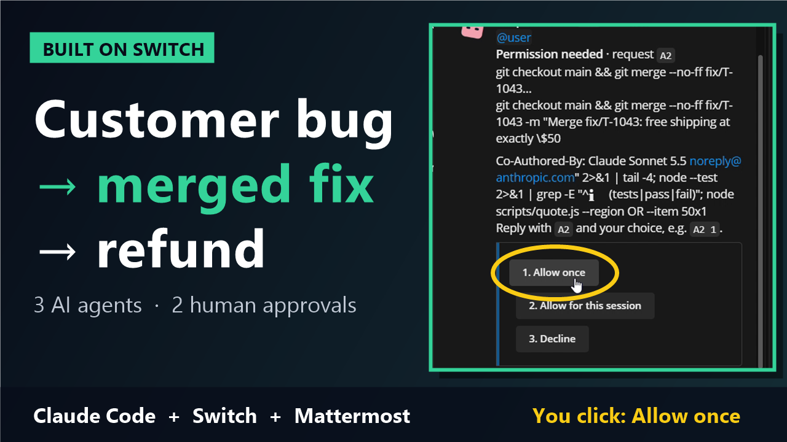
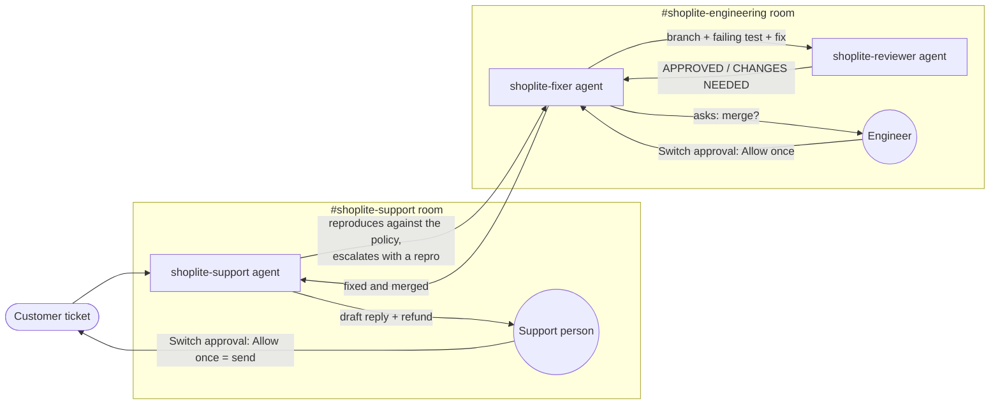

# Support-to-Ship Bridge

**Customer ticket in → reviewed, merged fix out → customer answered.**
**Three AI agents and the people on two teams handle it together in team chat, connected by [Switch](https://github.com/sandbox-quantum/switch).**

Built for the **Flip the Switch Hackathon** (WeMakeDevs × DevTools Academy × Switch). Track 01: Best Business Workflow.

### 🎥 [Watch the 2.5-minute demo](https://youtu.be/mUrFossp2F4)

[](https://youtu.be/mUrFossp2F4)

*A real, unscripted run: a customer ticket goes through reproduction, a fix with a regression test, review, a human-approved merge and a human-approved refund reply. Narration is AI-generated (Kokoro TTS).*

📝 **Blog post:** [I Built a Support-to-Engineering Pipeline with 3 AI Agents and 2 Human Approvals on Switch](https://dev.to/shiva_preetham/i-built-a-support-to-engineering-pipeline-with-3-ai-agents-and-2-human-approvals-on-switch-4hk0). A step-by-step build guide for first-time Switch users, including the gotchas.

---

## The problem

Every software company loses days at the same hand-off:

1. A customer writes in: *"I think I was overcharged."*
2. Support can't tell whether it's a bug. They paste it into an engineering channel.
3. Engineering asks for the order details again, someone eventually reproduces it, fixes it, gets it reviewed and merges it.
4. Nobody tells support, so the customer never hears back.

The work itself takes minutes. The waiting between people takes days.

## What this does

Two Switch rooms, linked, with three agents and the humans who own each decision:



| Step | Who | What actually happens |
|---|---|---|
| 1 | Support person | Pastes the ticket into **#shoplite-support** |
| 2 | `shoplite-support` | Restates it, **reproduces the wrong total** with `scripts/quote.js`, compares it with `docs/pricing-policy.md`, and decides whether it's a how-to or a bug |
| 3 | `shoplite-support` | Escalates to **#shoplite-engineering** in a fixed format: ticket id, the customer's words, repro command, actual vs expected, the exact policy line |
| 4 | `shoplite-fixer` | Creates `fix/<ticket>`, writes a **regression test that fails first**, makes the smallest fix, re-runs the tests and commits |
| 5 | `shoplite-reviewer` | Reviews the diff against the policy, runs the tests, approves or requests changes, and looks for the same bug elsewhere |
| 6 | Engineer | Says "yes" in the room, then approves Switch's **Permission needed** request for `git merge` |
| 7 | `shoplite-fixer` | Merges, re-tests `main`, and tells support it's fixed with the corrected numbers |
| 8 | `shoplite-support` | Drafts the customer reply with the **exact refund** and asks the support person to approve |
| 9 | Support person | Approves Switch's **Permission needed** request for `send-reply.js`, which is the send button |

### A real run (T-1042)

- **Ticket:** *"I used SAVE20 on a $120 jacket… tax on my receipt is $8.70… Was I overcharged?"*
- **Support agent:** "Actual: tax $8.70, total $104.70 (tax charged on the pre-discount $120). Policy: tax on discounted $96 × 7.25% = $6.96, total $102.96. This is a bug. Escalating."
- **Fixer:** root cause `calculateTotal` passed the pre-discount subtotal to `taxFor`. New regression test fails (8.7 vs 6.96), the fix passes it, 7/7 tests pass.
- **Reviewer:** APPROVED. *Without being asked*, it also flagged a second bug: "shippingFor uses `amount > 50` while the policy says free shipping at $50 or more."
- **Engineer:** approved the merge in Switch, so the merge commit lands on `main`.
- **Support agent:** drafted the customer reply with a **$1.74 refund**. The support person approved the send.

## How Switch is used (the project doesn't work without it)

| Switch feature | Where |
|---|---|
| **Rooms on a real chat app** (bundled Mattermost) | `#shoplite-support` and `#shoplite-engineering`, where people and agents talk in the same channels |
| **Room group + link** | Both rooms are one group. A link labelled *"escalate pricing bugs"* connects support → engineering |
| **Room instructions** | Each room tells every agent that joins what the room is for and what is never allowed (no pushes, nothing sent without approval) |
| **Room documents** | `escalation-checklist` in #shoplite-support defines what a good escalation contains |
| **Roles** | `reviewer` (shared) and `merge-captain` (exclusive, one holder) in #shoplite-engineering |
| **Agent-to-agent handoff** | Agents address each other with `@name`. support → fixer → reviewer → fixer → support, across two rooms |
| **Human-in-the-loop approvals** | Switch's *Permission needed → Allow once / Allow for this session / Decline* gates `git merge` and the customer send. Switch records who approved |
| **Addressing / access** | Agents accept work from their owner and the owner's agents only |
| **Kickoff messages** | The template posts a kickoff into each room, so the agents introduce themselves and the room is live immediately |
| **Templates** | `switch/support-to-ship-rooms.template.yaml` recreates both rooms, the link, docs, roles and kickoffs in one click |
| **Agents from multiple sessions** | Each agent is a separate Claude Code agent with its own instructions, all sharing one git workspace |

The approval gates are enforced, not just requested in a prompt. `demo-app/shoplite/.claude/settings.json` puts `git merge` and `send-reply.js` on the **ask** list and `git push` / `git reset --hard` on the **deny** list. The agent cannot merge or reply to a customer until a person allows it in the Switch room.

## Run it yourself

### Prerequisites
- [Switch Console](https://github.com/sandbox-quantum/switch/releases/latest) (tested on 0.40.1, Windows x64)
- [Docker Desktop](https://www.docker.com/products/docker-desktop/), which Switch Console uses for the bundled Mattermost
- [Claude Code](https://docs.claude.com/en/docs/claude-code) installed and signed in (`claude` → `/login`)
- Node.js 18+ and git

### 1. Create the workspace the agents work in
```powershell
# Windows
powershell -ExecutionPolicy Bypass -File scripts/setup-workspace.ps1
```
```bash
# macOS / Linux
bash scripts/setup-workspace.sh
```
This copies `demo-app/shoplite` into `~/switch-demo/shoplite` as its own git repo (so agents can branch, commit and merge) and prints the path. Run it again to reset before every demo.

### 2. Start Switch
Open Switch Console, then **Get started → On this computer → Start**. This starts the local Switch server and Mattermost. Then link your Mattermost account: **Home → Messaging apps → Mattermost → Link → This is me**.

### 3. Create the three agents
**Your Agents → +**, once per file in [`switch/agents/`](switch/agents):

| Name | Instructions | Directory |
|---|---|---|
| `shoplite-support` | [`switch/agents/shoplite-support.md`](switch/agents/shoplite-support.md) | the workspace path from step 1 |
| `shoplite-fixer` | [`switch/agents/shoplite-fixer.md`](switch/agents/shoplite-fixer.md) | same |
| `shoplite-reviewer` | [`switch/agents/shoplite-reviewer.md`](switch/agents/shoplite-reviewer.md) | same |

Run location: **This computer**. Provider: **Claude Code**.

### 4. Create the rooms
**Templates → Import template**, paste [`switch/support-to-ship-rooms.template.yaml`](switch/support-to-ship-rooms.template.yaml), save, then **Use → Create all**.

> Rooms take ~15 s each to provision. If the Console times out with "Could not reach the server", check **Your Rooms** before retrying. The rooms are usually already there.

### 5. Run a ticket
Paste a ticket from [`demo-app/tickets/`](demo-app/tickets) into **#shoplite-support**, addressed to `@shoplite-support`:

| Ticket | What it exercises |
|---|---|
| `T-1042` | Tax charged before the coupon. Full loop: escalate → fix → review → merge → refund reply |
| `T-1043` | Order of exactly $50 charged shipping. The boundary bug the reviewer finds on its own |
| `T-1044` | A plain how-to question. Answered directly, **no** escalation |

### One-shot template (macOS / Linux hosts)
[`switch/support-to-ship.template.yaml`](switch/support-to-ship.template.yaml) creates the three agents **and** both rooms in one run. It's the same workflow as one document. On Windows, Switch Console 0.40.1 can't run template-created agents on *This computer* (see Learnings), so use steps 3–4 there.

## Repository layout

```
demo-app/
  shoplite/            the "product": a tiny checkout pricing service (no dependencies)
    src/pricing.js       pricing logic with two planted bugs
    test/                node:test suite (passes, because the bugs aren't covered)
    docs/                pricing policy (source of truth) + support FAQ
    scripts/quote.js     reproduce any checkout from the command line
    scripts/send-reply.js  "send" a customer reply (gated by Switch approval)
    .claude/settings.json  ask/deny rules that turn merge + send into human approvals
  tickets/             sample customer tickets to paste into the support room
switch/
  agents/              instructions for the three agents
  support-to-ship-rooms.template.yaml   rooms, link, docs, roles, kickoffs
  support-to-ship.template.yaml         agents + rooms in one template (POSIX hosts)
scripts/
  setup-workspace.ps1 / .sh   create or reset the agent workspace
  wsl-host-setup.sh           optional: turn WSL Ubuntu into a Switch remote host
demo/
  edit-plan.json       the demo video's edit: segments, captions, narration script
  edit-video.ps1       cuts and speeds up the raw recording, zooms the approvals, adds captions (ffmpeg)
  tts.py               narration with Kokoro TTS (Apache-2.0), run locally
  make-thumbnail.ps1   builds the YouTube thumbnail from a real frame
  thumbnail.png
track-and-idea-comparison.md  how we chose the track and the idea
```

## What's next

- **Mix agent tools:** run `shoplite-reviewer` on Codex (or a LangChain agent on a server) so two different agent stacks check each other's work in the same room. Switch makes that a config change, not a rewrite.
- **Approval policies by role:** only the `merge-captain` holder or named engineers can approve a merge.
- **Help-desk connector** (Zendesk or Intercom), so tickets arrive in #shoplite-support without anyone pasting them.

## Learnings and notes for the Switch team

- **Windows templates.** In Switch Console 0.40.1 on Windows, a template's *Runs on → This computer* resolves to the machine id, which the Console then tries to reach **over SSH** (`agentTypes.listAvailabilityRemote: host unreachable`, `sshHost: <machine-uuid>`). Every provider shows "Not supported here", although agents created from **Your Agents → +** on the same machine run fine. That's why this repo ships both the one-shot template and an agents-by-hand + rooms-template path.
- **WSL as a remote host** works with WSL mirrored networking (`networkingMode=mirrored`), so the controller in WSL can reach the server on `127.0.0.1`. You also need a current Node.js linked into `/usr/local/bin`, because non-interactive SSH sessions don't load `~/.local/bin`. `scripts/wsl-host-setup.sh` captures the steps.
- **Free models and tool calls.** A free OpenRouter model couldn't produce the `post_message` tool call Switch agents reply through. Agents need a model with reliable tool use.
- **Long room provisioning** (~17 s per Mattermost room) can exceed the Console's request timeout, so it reports failure even though the rooms were created.

## Team
- Shiva Preetham ([@Shiva-Preetham](https://github.com/Shiva-Preetham))

Built with Switch, Claude Code and Mattermost.
